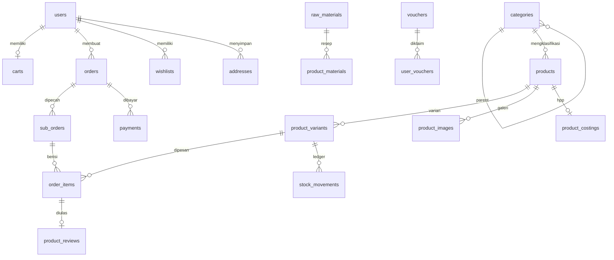

# Rincian Skema Database — Fashionku

Dokumen ini merinci skema database **aktif** project Fashionku.

- **Model data:** single-store. Tidak ada entitas "toko penjual" (multi-vendor);
  operator toko = role `admin`, pembeli = role `buyer`. Tidak ada komisi/biaya admin.
- **Sumber kebenaran:** 8 file migrasi di `database/migrations/`.
- **Jumlah tabel:** 60 tabel domain + `migrations` (metadata) = **61 tabel**.
- **Terakhir diperbarui:** 14 November 2026.

| Migrasi | Isi |
|---|---|
| `2026_11_14_000001_create_framework_tables` | 8 tabel infrastruktur Laravel |
| `2026_11_14_000002_create_identity_tables` | 9 tabel identitas & keamanan |
| `2026_11_14_000003_create_core_and_catalog_tables` | `app_settings`, alamat, ongkir, pelanggan, katalog |
| `2026_11_14_000004_create_marketing_tables` | promosi, voucher, jadwal, pola kode |
| `2026_11_14_000005_create_commerce_tables` | cart, wishlist, order, pembayaran, ulasan |
| `2026_11_14_000006_create_inventory_tables` | stok, bahan baku, HPP |
| `2026_11_14_000007_create_finance_tables` | keuangan toko |
| `2026_11_14_000008_create_communication_tables` | chat, tiket bantuan, notifikasi |

## Cara verifikasi

```bash
php artisan migrate:status
php artisan db:table nama_tabel   # kolom, index, foreign key
```

---

## Ringkasan

| Domain | Jumlah | Tabel |
|---|---|---|
| Identitas & keamanan | 9 | users, roles, permissions, user_roles, role_permissions, otp_challenges, registration_challenges, user_devices, security_events |
| Pengaturan toko & alamat | 4 | app_settings, addresses, shipping_settings, seller_customers |
| Katalog | 8 | categories, product_attributes, products, product_categories, product_attribute_values, product_variants, product_variant_values, product_images |
| Promosi & voucher | 4 | promotions, promotion_payments, vouchers, user_vouchers |
| Belanja & pesanan | 9 | carts, cart_items, wishlists, wishlist_items, orders, sub_orders, order_items, payments, product_reviews |
| Inventori & HPP | 7 | stock_movements, raw_materials, raw_material_stock_movements, raw_material_cost_histories, product_costings, product_materials, product_costing_impacts |
| Keuangan | 2 | financial_transactions, financial_payment_histories |
| Komunikasi & dukungan | 7 | conversations, conversation_participants, chat_messages, chat_message_reads, support_tickets, support_ticket_messages, admin_notifications |
| Operasional & penomoran | 2 | schedules, code_patterns |
| Infrastruktur framework | 8 | password_reset_tokens, sessions, cache, cache_locks, jobs, job_batches, failed_jobs, personal_access_tokens |

## Konvensi umum

- **PK:** `bigint unsigned auto increment` (`$table->id()`), kecuali `users`, `wishlists`,
  `otp_challenges`, `registration_challenges`, `user_devices`, `security_events` memakai `uuid`.
- **Soft delete:** kolom `deleted_at` pada tabel yang ditandai.
- **Audit:** `created_by` / `updated_by` bertipe `uuid` → FK ke `users.id` dengan `nullOnDelete()`.
- **Uang:** `decimal(15,2)`; kuantitas bahan baku/HPP `decimal(18,4)`.
- **Zona waktu:** mengikuti `config/app.php` (default `Asia/Jakarta`).
- **Tidak ada `store_id`** di tabel mana pun. Identitas toko tunggal disimpan sebagai
  key-value di `app_settings` (lihat `AppSettingService::storeProfile()`).

---

## 1. Identitas & Keamanan

### `users` — akun pengguna (PK `uuid`)
- **Kolom:** `id` uuid PK; `firebase_uid` string nullable unik; `email` string unik;
  `password` string nullable (null untuk akun Firebase-only); `has_set_password` bool default false;
  `name` nullable; `avatar` nullable; `is_email_verified` bool default false; `is_active` bool default true;
  `banned_at` timestamp nullable; `remember_token`; `created_by`/`updated_by` uuid nullable;
  `timestamps`; `deleted_at`.
- **Relasi:** self-FK `created_by`, `updated_by` → `users.id` (nullOnDelete).
- **Indeks:** unik `email`, `firebase_uid`, `users_access_status_index (is_active, banned_at, deleted_at)`.
- **Catatan:** role disimpan lewat `user_roles`, bukan kolom di tabel ini.

### `roles` — master role
- **Kolom:** `id`; `name` string(50) unik; `description` nullable; `is_active` bool default true;
  audit user; `timestamps`; `deleted_at`.
- **Catatan:** role bisnis aktif hanya `admin` (operator/pemilik toko) dan `buyer`.
  Role warisan (`seller`, dsb.) dinonaktifkan, bukan dihapus.

### `permissions` — master izin
- **Kolom:** `id`; `name` string(100) unik; `description` nullable; `is_active` bool default true; `timestamps`.

### `user_roles` — pivot user ↔ role
- **Kolom:** `user_id` uuid FK cascade; `role_id` FK cascade; `timestamps`.
- **PK:** `(user_id, role_id)`; indeks `(role_id, user_id)`.

### `role_permissions` — pivot role ↔ permission
- **Kolom:** `role_id`, `permission_id` (FK cascade), `timestamps`.
- **PK:** `(role_id, permission_id)`; indeks `(permission_id, role_id)`.

### `otp_challenges` — OTP login/verifikasi (PK `uuid`)
- **Kolom:** `id` uuid; `user_id` uuid nullable (hanya indeks, **tanpa FK**); `email`; `phone` nullable;
  `purpose` string(50); `code_hash`; `attempts` tinyint default 0; `max_attempts` smallint default 5;
  `expires_at`; `consumed_at` nullable; `challenge_id` nullable; `ip_address` string(45); `user_agent` text;
  `metadata` json; `timestamps`; `deleted_at`.
- **Indeks:** `(email, purpose, consumed_at)`, `(user_id, purpose, consumed_at)`, `(challenge_id, purpose)`.

### `registration_challenges` — data sementara pendaftaran (PK `uuid`)
- **Kolom:** `id` uuid; `email` unik; `name`; `password_hash`; `phone` nullable; `firebase_uid` nullable;
  `avatar` nullable; `otp_challenge_id` nullable; `ip_address`; `user_agent`; `metadata` json;
  `expires_at`; `timestamps`; `deleted_at`.

### `user_devices` — perangkat & sesi Sanctum (PK `uuid`)
- **Kolom:** `id` uuid; `user_id` uuid FK cascade; `device_name`; `device_type`; `browser`;
  `browser_version`; `os`; `os_version`; `ip_address` string(45); `sanctum_token_id` string unik;
  `sanctum_token_name`; `last_active_at`; `expires_at`;
  `status` enum(`active`,`inactive`,`revoked`,`expired`) default `active`; `metadata` json;
  `timestamps`; `deleted_at`.

### `security_events` — audit keamanan (PK `uuid`)
- **Kolom:** `id` uuid; `user_id` uuid nullable (tanpa FK); `email` nullable; `event_type` string(100);
  `purpose` nullable; `severity` enum(`info`,`warning`,`critical`) default `info`; `ip_address`;
  `user_agent`; `metadata` json; `success` bool default true; `failure_reason` text;
  `occurred_at` (default now); `timestamps`; `deleted_at`.

---

## 2. Pengaturan Toko & Alamat

### `app_settings` — konfigurasi aplikasi (key-value)
- **Kolom:** `id`; `group` string(50) default `general` (index); `key` string(120) unik;
  `value` text nullable; `type` string(20) default `string` (`string|boolean|integer|float|json`); `timestamps`.
- **Catatan:** menggantikan tabel `stores` + `store_details`. Profil toko tunggal disimpan dengan
  prefix `store.*` (`store.name`, `store.slug`, `store.description`, `store.phone`, `store.email`,
  `store.city`, `store.province`, `store.address`, `store.logo`, `store.banner_url`, `store.is_active`,
  `store.owner_name`, `store.owner_phone`, `store.shipping_policy`, `store.return_policy`,
  `store.open_days`, `store.open_time`, `store.close_time`, `store.whatsapp_url`, `store.instagram_url`,
  `store.tiktok_url`, `store.website_url`).
- **Akses:** `App\Domains\Shared\Settings\Application\Services\AppSettingService`.

### `addresses` — alamat pengguna
- **Kolom:** `id`; `user_id` uuid nullable FK cascade; `country`, `province`, `city_or_regency`,
  `district`, `subdistrict` string(100); `postal_code` string(20); `full_address` text; `notes` nullable;
  `label` string(100); `recipient_name`; `phone_number` string(20); `latitude` decimal(10,8);
  `longitude` decimal(11,8); `komerce_destination_id` string(50) nullable; `is_primary` bool; `timestamps`.
- **Indeks:** `(user_id, is_primary)`.
- **Catatan:** alamat toko (label `Toko`) adalah baris milik user admin; tidak ada `store_id`.

### `shipping_settings` — pengaturan ongkir toko (singleton)
- **Kolom:** `id`; `origin_destination_id` string(50) nullable; `store_latitude` decimal(10,8);
  `store_longitude` decimal(11,8); `free_shipping_max_distance` decimal(8,2) default 0;
  `default_flat_rate` decimal(15,2) default 0; `rate_per_km` decimal(15,2) default 0; `timestamps`.
- **Catatan:** hanya satu baris (toko tunggal); dibaca dengan `orderBy('id')->first()`.

### `seller_customers` — pelanggan toko
- **Kolom:** `id`; `user_id` uuid **unik** FK cascade; `note` nullable; audit user; `timestamps`.
- **Catatan:** menandai pembeli yang ditambahkan manual oleh admin; satu baris per user.

---

## 3. Katalog

### `categories` — kategori hierarkis 3 level
- **Kolom:** `id`; `parent_id` self-FK cascade; `parent_scope_id` bigint default 0;
  `level` tinyint default 1 (1–3); `sort_order`; `is_active`; `is_visible_in_menu`; `name`; `slug`;
  `full_slug` unik; `image_url`; `icon_url`; audit user; `timestamps`; `deleted_at`.
- **Unik:** `(parent_scope_id, name)`; indeks `(parent_id, sort_order)`, `(is_active, is_visible_in_menu, deleted_at)`.
- **CHECK (MySQL):** media (`image_url`/`icon_url`) hanya boleh diisi saat `level = 3`.

### `product_attributes` — master atribut (warna, ukuran, dll.)
- **Kolom:** `id`; `name` unik; `slug` unik; `type` string(50) default `select`; `timestamps`.

### `products` — produk
- **Kolom:** `id`; `primary_category_id` nullable FK nullOnDelete; `name` unik; `slug` unik;
  `description` nullable; `brand` string(100) nullable; `thumbnail`; `status` enum(`draft`,`published`,`archived`)
  default `published`; `is_active`; `allows_preorder` bool default true; audit user; `timestamps`; `deleted_at`.
- **Indeks:** `products_public_feed_index (status, is_active, deleted_at)`,
  `(primary_category_id, status, is_active)`, `(status, is_active, created_at, id)`,
  `(primary_category_id, status, is_active, created_at, id)`, `(name, id)`.
- **Catatan:** karena single-store, `name` unik global (bukan unik per toko).

### `product_categories` — pivot produk ↔ kategori
- **Kolom:** `product_id`, `category_id` (FK cascade), `is_primary` bool, `timestamps`.
- **PK:** `(product_id, category_id)`; indeks `(category_id, product_id)`.

### `product_attribute_values` — nilai atribut level produk
- **Kolom:** `id`; `product_id` FK cascade; `attribute_id` FK cascade; `value` text; `timestamps`.
- **Unik:** `(product_id, attribute_id)`.

### `product_variants` — SKU & stok
- **Kolom:** `id`; `product_id` FK cascade; `sku` string(100) unik (global); `name`;
  `price` decimal(15,2); `price_original` decimal(15,2) nullable; `price_sale` decimal(15,2) nullable;
  `stock` int; `po_stock` int (preorder/PO); `stock_reserved`; `stock_booked`; `stock_preorder`;
  `max_order_qty` default 999999; `min_stock`; `is_default`; `timestamps`.
- **Unik:** `sku`, `(product_id, name)`.
- **Indeks:** `(product_id, is_default)`, `(product_id, is_default, id)`, `sku`,
  `(product_id, is_default, price, id)`, `(product_id, is_default, stock, id)`,
  `(product_id, stock)`, `(price_sale, is_default)`.

### `product_variant_values` — nilai atribut per varian
- **Kolom:** `id`; `variant_id` FK cascade; `attribute_id` FK cascade; `value` string; `timestamps`.
- **Unik:** `(variant_id, attribute_id)`.

### `product_images` — galeri produk
- **Kolom:** `id`; `product_id` FK cascade; `url`; `alt_text`; `is_primary`; `sort_order`; `timestamps`.
- **Indeks:** `(product_id, is_primary, sort_order)`.

---

## 4. Promosi & Voucher

### `promotions` — banner/iklan promosi dengan approval
- **Kolom:** `id`; `promotion_payment_id` nullable FK nullOnDelete; `name` string(150) unik;
  `image_url`; `mobile_image_url`; `click_action` enum(`none`,`product`,`category`,`url`);
  `target_id`; `target_url`; `sort_order`; `is_active`;
  `approval_status` enum(`pending`,`approved`,`rejected`); `rejection_reason`; `submitted_at`;
  `approved_at`; `approved_by` uuid; audit user; `timestamps`; `deleted_at`.
- **Indeks:** `(approval_status, is_active, sort_order, deleted_at)`, `(promotion_payment_id, approval_status)`.

### `promotion_payments` — pembayaran paket promosi
- **Kolom:** `id`; `user_id` uuid FK cascade; `payment_number` unik; `package_name`; `amount`;
  `payment_method`; `proof_url`; `status` default `pending`; `rejection_reason`; `paid_at`;
  `reviewed_at`; `reviewed_by` uuid; `is_active`; audit user; `timestamps`; `deleted_at`.

### `vouchers` — voucher toko
- **Kolom:** `id`; `code` string(50) unik; `name` string(100) unik; `image`;
  `discount_target` enum(`product`,`shipping`); `discount_type` enum(`fixed`,`percentage`);
  `discount_value`; `min_spend`; `min_items` nullable; `min_distinct_products` nullable; `terms` text;
  `max_discount`; `starts_at`; `ends_at`; `usage_limit` default 0 (0 = tanpa batas); `used_count`;
  `is_active`; audit user; `timestamps`; `deleted_at`.
- **Indeks:** `(is_active, starts_at, ends_at, deleted_at)`, `discount_target`, `starts_at`, `ends_at`.
- **Catatan:** `voucher_scope` dan `store_id` dihapus — seluruh voucher berlaku untuk toko tunggal.

### `user_vouchers` — voucher yang diklaim user
- **Kolom:** `id`; `user_id` uuid FK cascade; `voucher_id` FK cascade; `source_type`; `source_id`;
  `status` default `available`; `claimed_at`; `used_at` nullable; `timestamps`.
- **Unik:** `(user_id, voucher_id, source_type, source_id)`.

---

## 5. Belanja & Pesanan

### `carts` — keranjang (1:1 user)
- **Kolom:** `id`; `user_id` uuid **unik** FK cascade; `timestamps`.

### `cart_items`
- **Kolom:** `id`; `cart_id` FK cascade; `product_variant_id` FK cascade; `quantity` default 1; `timestamps`.
- **Unik:** `(cart_id, product_variant_id)`.

### `wishlists` — daftar keinginan (PK `uuid`)
- **Kolom:** `id` uuid; `user_id` uuid FK cascade; `name` string(100) default `utama`; `timestamps`.
- **Unik:** `(user_id, name)`.

### `wishlist_items`
- **Kolom:** `id`; `wishlist_id` uuid FK cascade; `product_id` FK cascade; `added_at` (default now).
- **Unik:** `(wishlist_id, product_id)`; tanpa `timestamps`.

### `orders` — header pesanan
- **Kolom:** `id`; `order_number` string(100) unik; `order_type` string(30) default `normal`;
  `preorder_release_at`; `scheduled_at` (jadwal kirim/pickup); `received_at`; `user_id` uuid FK cascade;
  `voucher_id` nullable FK nullOnDelete; `total_amount`; `discount_amount`; `shipping_discount_amount`;
  `status` string(50) default `pending`; `payment_status` string(50) default `unpaid`; `payment_method`;
  `midtrans_snap_token`; `shipping_address` text; `timestamps`.
- **Indeks:** `(user_id, created_at)`, `(user_id, status, created_at)`, `(payment_status, created_at)`,
  `order_type`, `preorder_release_at`, `scheduled_at`, `received_at`.
- **Catatan:** `admin_fee` dan `seller_net` dihapus (tidak ada komisi).

### `sub_orders` — pengelompokan item pesanan per pengiriman
- **Kolom:** `id`; `order_id` FK cascade; `sub_order_number` unik; `total_items_price`;
  `shipping_cost`; `courier`; `service`; `destination_id` string(50); `status` default `pending`;
  `tracking_number`; `timestamps`.
- **Indeks:** `(status, created_at)`, `(order_id)`.
- **Catatan:** dulu dipecah per toko; sekarang murni per pengiriman.

### `order_items` — snapshot item pesanan
- **Kolom:** `id`; `sub_order_id` FK cascade; `product_id` FK **restrict**; `variant_id` nullable FK nullOnDelete;
  `product_name`; `sku`; `thumbnail` nullable; `price`; `quantity`; `timestamps`.
- **Indeks:** `(product_id, created_at)`.

### `payments` — transaksi pembayaran gateway
- **Kolom:** `id`; `order_number` string(100) FK → `orders.order_number` cascade; `transaction_id` nullable unik;
  `payment_method`; `amount`; `status` default `pending`; `payload` longText; `timestamps`.

### `product_reviews` — ulasan produk
- **Kolom:** `id`; `product_id` FK cascade; `order_id` FK cascade; `order_item_id` **unik** FK cascade;
  `user_id` uuid FK cascade; `rating` tinyint (1–5); `review` text; `media` json; `is_active`;
  audit user; `timestamps`; `deleted_at`.
- **Indeks:** `(product_id, is_active, created_at)`, `rating`.

---

## 6. Inventori & HPP

### `stock_movements` — ledger stok varian
- **Kolom:** `id`; `product_id` FK cascade; `variant_id` FK cascade; `order_id` nullable FK nullOnDelete;
  `order_item_id` nullable FK nullOnDelete; `movement_key` string(120) nullable; `type` string(30);
  `quantity_delta` int (boleh negatif); `balance_after` int; `stock_dimension` string(20) default `available`;
  `reference_type`; `reference_id`; `notes`; `occurred_at`; audit user; `timestamps`; `deleted_at`.
- **Unik:** `(order_item_id, movement_key)` — idempotensi saat retry.
- **Indeks:** `(variant_id, occurred_at)`, `(product_id, occurred_at)`.

### `raw_materials` — bahan baku
- **Kolom:** `id`; `code` string(100) unik; `name`; `unit` default `pcs`; `stock` decimal(18,4);
  `minimum_stock` decimal(18,4); `average_cost` decimal(18,4); `is_active`; `timestamps`; `deleted_at`.
- **Indeks:** `name`.

### `raw_material_stock_movements` — ledger bahan baku
- **Kolom:** `id`; `raw_material_id` FK cascade; `type` string(30); `quantity_delta` decimal(18,4);
  `balance_after` decimal(18,4); `unit_cost`; `total_cost`; `reference_type` default `manual`;
  `reference_number`; `notes`; `occurred_at`; `timestamps`.
- **Indeks:** `(raw_material_id, occurred_at)`.

### `raw_material_cost_histories` — riwayat harga rata-rata bahan
- **Kolom:** `id`; `raw_material_id` FK cascade; `raw_material_stock_movement_id` nullable FK nullOnDelete;
  `old_average_cost`; `new_average_cost`; `change_amount`; `change_percent`; `direction` default `unchanged`;
  `reference_type` default `restock`; `reference_number`; `occurred_at`; `timestamps`.

### `product_costings` — HPP per produk (1:1)
- **Kolom:** `id`; `product_id` **unik** FK cascade; `material_cost`; `labor_cost`; `overhead_cost`;
  `other_cost`; `hpp`; `margin_percent`; `suggested_price`; `selling_price`; `timestamps`.

### `product_materials` — resep/BOM produk
- **Kolom:** `id`; `product_id` FK cascade; `raw_material_id` FK cascade; `quantity`; `unit_cost`;
  `total_cost`; `timestamps`.
- **Unik:** `(product_id, raw_material_id)`.

### `product_costing_impacts` — dampak perubahan biaya bahan ke HPP
- **Kolom:** `id`; `product_id` FK cascade; `raw_material_id` nullable FK nullOnDelete;
  `raw_material_cost_history_id` nullable FK nullOnDelete; `old_material_cost`; `new_material_cost`;
  `old_hpp`; `new_hpp`; `hpp_change_amount`; `hpp_change_percent`; `old_suggested_price`;
  `new_suggested_price`; `trigger_type` default `raw_material_cost_change`; `occurred_at`; `timestamps`.
- **Indeks:** `(product_id, occurred_at)`.

---

## 7. Keuangan

### `financial_transactions` — buku kas & tagihan
- **Kolom:** `id`; `order_id` nullable FK nullOnDelete; `user_id` nullable FK nullOnDelete;
  `reference_number` unik; `type` string(30); `category` string(40) nullable; `title`; `description`;
  `amount`; `paid_amount`; `status` default `open`; `due_date` date; `occurred_at`; `settled_at`;
  `is_active`; `metadata` json; audit user; `timestamps`; `deleted_at`.
- **Indeks:** `(type, status, occurred_at)`, `(type, due_date, status)`.

### `financial_payment_histories` — riwayat pembayaran transaksi
- **Kolom:** `id`; `financial_transaction_id` FK cascade; `recorded_by` uuid nullable FK nullOnDelete;
  `amount`; `balance_before`; `balance_after`; `payment_method` default `manual`; `reference_number`;
  `notes`; `paid_at`; `timestamps`.
- **Indeks:** `(financial_transaction_id, paid_at)`.

---

## 8. Komunikasi & Dukungan

### `conversations` — ruang chat
- **Kolom:** `id`; `type` string(30) default `direct` (`direct|order|store|announcement`);
  `order_id` nullable FK nullOnDelete; `subject`; `target_role`; `is_active`; audit user;
  `timestamps`; `deleted_at`.
- **Indeks:** `type`, `target_role`, `(order_id, type)`.

### `conversation_participants` — peserta chat
- **Kolom:** `conversation_id` FK cascade; `user_id` uuid FK cascade; `last_read_at`; `joined_at`;
  `left_at`; `is_muted`; PK `(conversation_id, user_id)`; indeks `(user_id, left_at)`.

### `chat_messages`
- **Kolom:** `id`; `conversation_id` FK cascade; `sender_id` uuid nullable FK nullOnDelete;
  `message_type` default `text`; `message`; `attachments` json; `edited_at`; `timestamps`; `deleted_at`.
- **Indeks:** `(conversation_id, created_at)`.

### `chat_message_reads`
- **Kolom:** `message_id` FK cascade; `user_id` uuid FK cascade; `read_at`; PK `(message_id, user_id)`.

### `support_tickets` — tiket bantuan
- **Kolom:** `id`; `ticket_number` unik (format `HLP-…`); `user_id` uuid FK cascade; `order_id` nullable FK nullOnDelete;
  `category`; `subject`; `description`; `priority` default `normal`; `status` default `open`;
  `assigned_to` uuid nullable FK nullOnDelete; `last_replied_at`; `resolved_at`; `is_active`;
  audit user; `timestamps`; `deleted_at`.

### `support_ticket_messages` — balasan tiket
- **Kolom:** `id`; `ticket_id` FK cascade; `user_id` uuid FK cascade; `message`; `attachments` json;
  `is_internal`; `read_at`; `timestamps`; `deleted_at`.

### `admin_notifications` — notifikasi in-app
- **Kolom:** `id`; `user_id` uuid FK cascade; `actor_id` uuid nullable FK nullOnDelete; `module`;
  `type`; `title`; `message`; `reference_type`; `reference_id`; `url`; `meta` json; `read_at`;
  `is_active`; `timestamps`; `deleted_at`.
- **Indeks:** `(user_id, read_at, created_at)`, `(user_id, module, read_at)`, `(reference_type, reference_id)`.

---

## 9. Operasional & Penomoran

### `schedules` — kalender/kanban operasional
- **Kolom:** `id`; `user_id` uuid FK cascade; `title`; `description`; `type`; `status` default `todo`;
  `position`; `assignee`; `label`; `priority` default `normal`; `color` default `#10B981`; `date`;
  `capacity` default 1; `recurrence` default `none`; `start_time`; `end_time`; `is_all_day`;
  `is_completed`; `completed_at`; `metadata` json; `completion_proof` json; `is_active`; audit user;
  `timestamps`; `deleted_at`.
- **Indeks:** `(user_id, date, is_active)`, `(user_id, is_completed, date)`, `(date, capacity)`.

### `code_patterns` — pola penomoran dokumen
- **Kolom:** `id`; `type` string(40); `pattern` string(120); `timestamps`.
- **Indeks:** `type`.

---

## 10. Infrastruktur Framework

| Tabel | Kolom utama |
|---|---|
| `password_reset_tokens` | `email` (PK), `token`, `created_at` |
| `sessions` | `id` (PK), `user_id` uuid (indeks, tanpa FK), `ip_address`, `user_agent`, `payload`, `last_activity` |
| `cache` | `key` (PK), `value` mediumText, `expiration` |
| `cache_locks` | `key` (PK), `owner`, `expiration` |
| `jobs` | `id`, `queue` (indeks), `payload`, `attempts`, `reserved_at`, `available_at`, `created_at` |
| `job_batches` | `id` (PK), `name`, `total_jobs`, `pending_jobs`, `failed_jobs`, `failed_job_ids`, `options`, `cancelled_at`, `created_at`, `finished_at` |
| `failed_jobs` | `id`, `uuid` (unik), `connection`, `queue`, `payload`, `exception`, `failed_at` |
| `personal_access_tokens` | `id`, `tokenable` (uuid morph), `name`, `token` (unik), `abilities`, `last_used_at`, `expires_at` |

---

## 11. Relasi Inti



Alur utama:

```
users → carts → cart_items → product_variants → products → categories
users → orders → sub_orders (per pengiriman) → order_items → product_variants
                └→ payments (via order_number)
product_variants → stock_movements (ledger stok)
orders → financial_transactions (pemasukan toko)
```

---

## 12. Tabel & Kolom yang Sudah Dihapus

| Objek | Status |
|---|---|
| `stores`, `store_details` | Dihapus. Profil toko tunggal pindah ke `app_settings` (`store.*`). |
| `admin_fee_configs`, `seller_settlements`, `seller_withdrawals` | Dihapus. Komisi/biaya admin/settlement dihapus dari produk. |
| Kolom `store_id` (semua tabel) | Dihapus; single-store. |
| Kolom `voucher_scope` | Dihapus; seluruh voucher berlaku untuk toko tunggal. |
| Kolom `orders.admin_fee`, `orders.seller_net`, `sub_orders.admin_fee`, `sub_orders.seller_net` | Dihapus; tidak ada komisi. |
| `showcases`, `showcase_products` | Dihapus; tidak dipakai kode. |
| `banners` | Dihapus; digantikan `promotions`. |
| `catalog_groups` | Dihapus; kategori murni hierarkis via `parent_id`. |
| `booking_expires_at` (kolom `orders`) | Dihapus; diganti `scheduled_at`. |
| `game_contents`, `game_sessions`, `missions`, `mission_user_progress`, `ppob_*` (7 tabel), `receipts`, `invoices` | Warisan dump SQL lama; tidak pernah dibuat migrasi dan tidak dipakai kode. |

Migrasi lama (36 file di `database/migrations/` + 3 di `database/upgrade-migrations/`) sudah digantikan
oleh 8 migrasi konsolidasi di atas. Jika database produksi masih menyimpan tabel warisan, tabel tersebut
aman dihapus setelah dipastikan datanya tidak dibutuhkan.